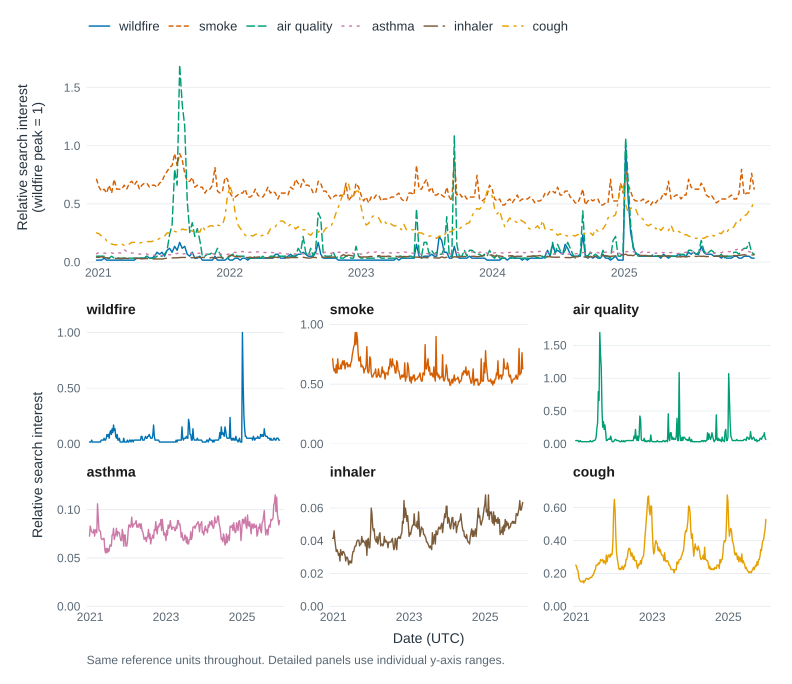

Collect Google Trends data in Python or [R](docs/r-usage.Rmd).



*California · requested 2021–2025 · six terms · 262 weekly dates. Full timelines,
calibrated to the wildfire peak.*

## Install

Python 3.9+:

```bash
python -m pip install "git+https://github.com/maxwellkonnaris/googletrends.git@main"
```

## Pull

```python
from trendspull import pull_trends

data = pull_trends(
    ["wildfire", "smoke", "air quality", "asthma", "inhaler", "cough"],
    start="2021-01-01", end="2025-12-31", geo="US-CA",
    min_gap_days=None,  # Keep all dates; use e.g. 28 to space them.
)
data[["date", "keyword", "calibrated_value"]].head()
data.to_csv("trends.csv", index=False)
```

Returns a pandas DataFrame: one row per date, term and region. Up to five terms
share Google's 0–100 scale; larger sets automatically use G-TAB calibration.
`value` preserves the raw index; `calibrated_value` uses the first term's peak as 1.
Values describe relative search interest, not counts or disease incidence.
Date spacing does not guarantee independence. See [options and output](docs/data-contract.md).
