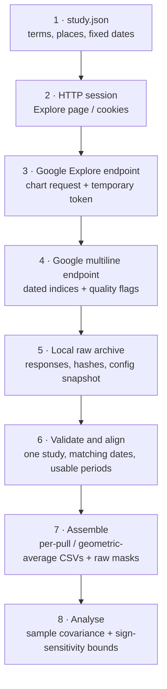

# trendspull

Collect and audit Google Trends timelines, then examine how unknown total-search
variation could change the covariance signs of logged search counts.

The supplied study has **12 search terms × 7 California geographies = 84 series**,
for **2021-01-01 through 2025-12-31**. Search indices are relative search interest;
this project does not observe absolute search counts or measure health effects.

## Follow the data



### 1. Specify the study locally

`load_config()` reads `study.json`. A job is one term and one geography, with the
same time window, category and search property. The defaults are web search,
all categories, `hl=en-US` and `tz=0` (UTC). `role` fields are descriptive labels;
they do not fit an exposure/outcome model or change the analysis.

Labels and resulting filenames must be unique. The study window is fixed;
relative date expressions are rejected. The exact config bytes are hashed.
Even a whitespace edit changes that hash: use a new output directory for a
changed specification. The assembly log replacement is recorded separately in generated quality metadata,
so changing it does not require a new Google download.

### 2. Start a session with Google

`TrendsClient` uses Python `requests.Session`, with browser-style User-Agent,
Accept-Language and Referer headers. It first opens:

```text
GET https://trends.google.com/trends/explore?geo=US
```

The session keeps cookies if Google supplies them. This step is best effort;
it does not guarantee access. In the original review's live probe, the warmup
page returned 429 but both chart requests subsequently returned 200.
No Google password or user API key is configured.

### 3. Request the chart definition

```text
GET https://trends.google.com/trends/api/explore
```

The URL query parameters contain `hl`, `tz` and a JSON `req`. For example:

```json
{
  "comparisonItem": [
    {"keyword": "wildfire", "geo": "US-CA", "time": "2021-01-01 2025-12-31"}
  ],
  "category": 0,
  "property": ""
}
```

Google returns JSON with widgets. The code removes the anti-hijacking prefix,
selects the `TIMESERIES` widget, and extracts its request object and temporary
token. This is Google's chart token, not a separately obtained API key.

### 4. Request the timeline values

```text
GET https://trends.google.com/trends/api/widgetdata/multiline
```

Pass `hl`, `tz`, the returned widget request as JSON `req`, and its `token`.
Read `default.timelineData`, retaining:

| Google field | Local meaning |
|---|---|
| `time` | Unix timestamp, converted to a UTC date label |
| `value[0]` | Integer relative index, 0–100 |
| `formattedValue[0]` | Displayed value, including `<1` |
| `hasData[0]` | Whether Google marks the observation as available |
| `isPartial` | Whether the period is incomplete |

If these flags are absent, `hasData` defaults to true and `isPartial` to false;
that is an explicit compatibility assumption. Values below 1 or displayed as
`<1` get a separate `low_volume` flag. Empty responses, invalid indices and
duplicate/out-of-order dates fail validation.

A live probe of the original client on 2026-11-26 returned **262 weekly points**
for wildfire/California, labeled **2020-12-27 through 2025-12-28**. A weekly bucket
can begin before the nominal start date; dates are preserved as returned.

These are **unofficial Google Trends website endpoints**. They can change or
rate-limit access. The [official Trends API alpha](https://developers.google.com/search/apis/trends)
is a separate, application-gated service and is not implemented here.

### 5. Archive and resume locally

Each acquisition date has a folder under `data/raw/<UTC-date>/`. A series JSON
contains both response texts. The manifest records its SHA-256 checksum,
request/completion times, config hash, tool/source identity, and Python,
requests, NumPy and pandas versions. `config.json` preserves the exact config.

Writes use a temporary file and atomic replacement. A same-day resume verifies
each successful raw file before skipping it; damaged or missing files are
retrieved again. Empty timelines never count as successful. Incomplete pulls
exit nonzero and stop a `--repeat` sequence. A pull stops starting new requests
when its UTC date changes. A request already in flight may finish after midnight;
its timestamps are retained.

`--repeat N` schedules acquisitions on separate UTC days. **Independence or a
new Google sample on every UTC day is not established.** Do not treat N pulls
as N independent observations without additional evidence. Do not run two
processes against the same output directory concurrently.

HTTP 429, server errors and connection errors have bounded retries and backoff.
Other HTTP failures stop that series immediately; there is no sleep after the
last failed attempt. Repeated failures can still take tens of minutes per series.

### 6. Verify and select common usable dates

Assembly makes no network requests. It requires:

- Every manifest's config hash to match the supplied config.
- Every configured series to be present and successful in every included pull.
- Series query/region/label metadata and raw filenames to match the study.
- Every raw file to match its checksum and recorded observation count.
- Identical, regular daily, weekly or monthly source date grids within each region.

Within a region, a date is usable only when **every term in every pull** has
`hasData=true` and `isPartial=false`. Unusable dates are excluded consistently
from all derived series in that region, with counts reported in summaries and
quality metadata. The tidy raw table retains all original flags and rows.
This complete-date rule is conservative and changes the time population described;
inspect excluded dates rather than assuming exclusions are harmless.

### 7. Assemble and preserve censoring information

For each term, replace below-resolution values by the assembly `--floor` (default 0.5),
take logs, center each pull over retained dates, average centered logs, exponentiate
and rescale the result to a maximum of 100. This is a **centered geometric average**,
not an arithmetic average of raw indices.

Each per-pull/averaged region directory includes `trends_quality.json` with the
original low-volume dates for each term/pull, config identity, retained dates,
exclusion count, log floor and CSV checksums. Keep it with its CSVs. Generated
exports are rejected if the sidecar is missing, stale or inconsistent.

The analysis filter uses the **largest raw below-resolution fraction across
pulls** in the selected date window. The default removes terms above 10% in any
pull. This conservative screening choice is an analysis assumption, not a
Google rule. Averaging/rescaling cannot make a censored term evade it.

### 8. Calculate sign sensitivity

`trends_sign_regions.py` loads one region, screens terms, clips by the positive
analysis floor, takes logs, removes constant terms, and computes sample covariances.
It requires at least 20 selected dates and two varying retained terms.

For each pair it reports the covariance/correlation of logged indices and the
lower/upper total-search log-SD values at which zero covariance becomes attainable.
The unknown total-search SD is a sensitivity parameter; the tool does not estimate
it. The [method and assumptions](docs/methods.md) explain the bounds and their limits.

## Run one step at a time

Requires Python 3.9+ and the three runtime libraries in `requirements.txt`.
Install in your own virtual environment, then start with a single access check:

```bash
python -m pip install -r requirements.txt
python trendspull.py check --config study.json
```

Expected on access success: `OK: 'wildfire' in US-CA, ... points, ... to ...`.
A 429 or network error is an access failure, not a scientific finding.

After reviewing that result, a full single-day pull is:

```bash
python trendspull.py pull --config study.json --out data
```

It requests 84 series sequentially, with 8–20 seconds between series and 2–5
seconds between chart requests. On responsive connections, expect tens of
minutes; rate limits can extend this greatly. Retry the same command on the
same UTC date to resume. This repository does not start full pulls automatically.

After a complete archive exists:

```bash
python trendspull.py assemble --config study.json --out data
python trends_sign_regions.py data/averaged/US-CA
```

Optional repeated acquisitions: append `--repeat 10` to `pull`. This can keep the
process running for about ten days. It is not a statistical independence guarantee.

## Outputs

| Path | Contents |
|---|---|
| `data/raw/<date>/` | Raw response texts, manifest, exact config snapshot |
| `data/tidy_all_pulls.csv` | All original rows plus availability, partial and low-volume flags |
| `data/pull_summary.csv` | Retained/excluded dates, pull counts, raw low-volume fractions, descriptive between-pull spread |
| `data/by_pull/<date>/<region>/` | Per-pull CSVs and quality sidecar |
| `data/averaged/<region>/` | Geometric-average CSVs and quality sidecar |
| `trends_pair_sign_regions*.csv` | Pairwise covariance/correlation and sign-sensitivity thresholds |
| `trends_log_share_covariance*.csv` | Covariance matrix with term names on rows and columns |

Assembly overwrites derived outputs under the requested `--out`. Analysis overwrites
its named result CSVs in the chosen region folder. Raw collection writes one date's
files and repairs invalid same-day files on resume; preserve a separate immutable
backup for a publication deposit.

A window can be selected with `--start` and `--end`; the 20-date rule and raw
low-volume filter are reapplied to that window. `--floor` changes analysis clipping.
To vary the replacement used *before averaging*, rerun `assemble --floor 0.25`
against the same raw archive (this overwrites derived outputs; preserve earlier
derived results separately for comparison). No new Google download is required.
The assembly floor must lie strictly between zero and one and is recorded as
`log_floor` in the quality sidecar. Changing the analysis floor alone cannot undo
the previously chosen geometric aggregation.

Standalone original Trends downloads are also accepted if every CSV identifies
its geography and shares identical dates. Repeated terms or mixed geographies
are rejected. Without generated quality metadata, raw below-resolution fractions
are calculated from those original CSV values.

## Offline tests

```bash
python -m pip install -r requirements-dev.txt
python -m pytest -q
```

All tests use synthetic responses and temporary output folders; no Google access
is needed. Tests cover the request chain, archive integrity, config isolation,
resume, flags, censoring after averaging, date alignment, numerical bounds and
CLI failures. GitHub Actions runs them on Python 3.9, 3.12 and 3.13.

## What is versioned

Git tracks source, `study.json`, dependency declarations, tests, CI and documentation.
Raw downloads, generated analyses, caches, environments and credentials are ignored.
Do not use an unignored custom `--out` path for research data inside this repository
without adding an appropriate ignore rule first.

No DVC, Docker/Apptainer or MLflow setup is included: this initial small tool does
not yet need data distribution, a portable cluster environment or repeated model
tracking. Add the smallest relevant tool when those needs exist. No research data
are pushed by this project. Dependency lower bounds are not a lockfile; manifests
record runtime versions, but that alone does not reproduce future Google samples.

## Version 2 changes

Study hashes are checked across all assembled days; raw flags survive assembly;
raw censoring controls filtering after averaging; incomplete/empty pulls fail;
resume verifies files; filename collisions and invalid inputs are rejected;
constant/tiny analyses fail clearly; covariance exports include row labels.
The pairwise mathematical bound is unchanged. Original valid complete archives
can be assembled when their configuration and checksums match; legacy archives
without config snapshots use the supplied config plus its matching manifest hash.

The starting material was the supplied `trendspull.zip` (SHA-256
`718fad10b962327ca8fe5e6b84c23eeb871815f7c868ad6b6a6ab32bc852bc30`).
No license was inferred from the archive; set an appropriate license before
public distribution.
