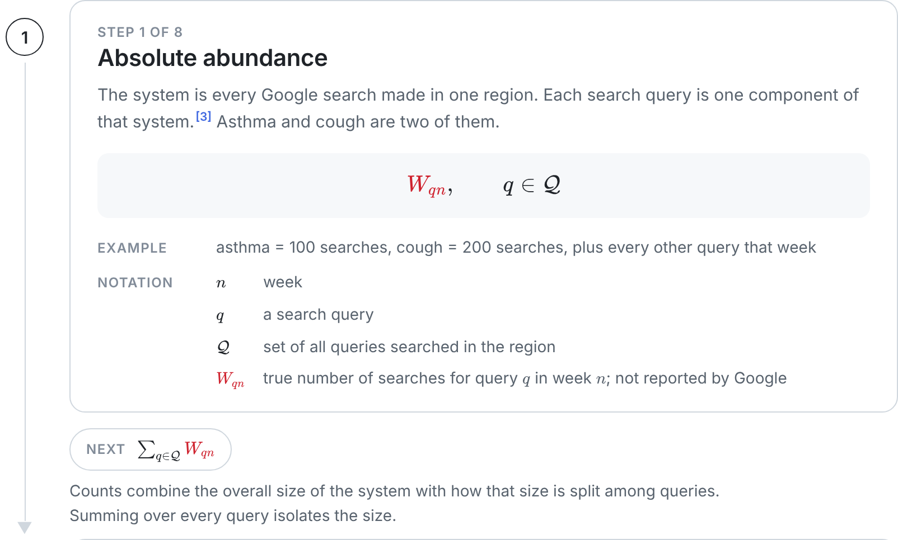
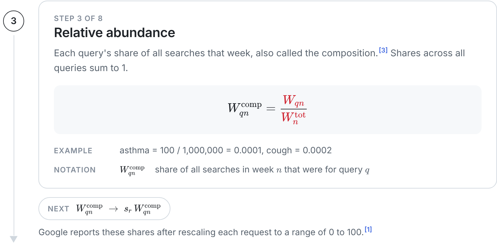

Collect Google Trends data in Python or [R](docs/r-usage.Rmd).


*California · requested 2021–2025 · six terms · 262 weekly dates.
For display, all calibrated values share one rescaling: 100 is the highest
interest across all terms and dates, not each term's own peak.*

## Install

Python 3.11+ · [MIT license](LICENSE). Development snapshot; no release has been tagged.

```bash
python -m pip install "git+https://github.com/maxwellkonnaris/googletrends.git@e9d64843d31b21d7c1ec763e863279a60a2e8988"
```

## Pull

```python
from trendspull import pull_trends, selected_proportions

# Step 1: Collect the data, preserving raw and calibrated values.
data = pull_trends(
    ["wildfire", "smoke", "air quality", "asthma", "inhaler", "cough"],
    start="2021-01-01", end="2025-12-31", geo="US-CA",
    min_gap_days=None,  # Keep all dates; use e.g. 28 to space them.
)

# Step 2: Transform to a terms × weeks matrix; each column sums to 1.
proportions = selected_proportions(data)
proportions.iloc[:, :3]
```

`pull_trends` returns a pandas DataFrame: one row per date, term and region. Up to five terms
share Google's 0–100 scale; larger sets automatically use G-TAB calibration
([West, 2020](https://doi.org/10.1145/3340531.3412075)).
`value` preserves the raw index; `calibrated_value` is relative to the first term's
peak (1), so other terms can exceed 1.
Values describe relative search interest, not counts or disease incidence.
Date spacing does not guarantee independence. See [options and output](docs/data-contract.md).

`selected_proportions(data)` returns a separate pandas DataFrame: terms as rows,
dates as columns, normalized among the supplied terms. It uses calibrated values
when applicable, otherwise the shared raw scale. The collected `data` is unchanged.
Use the original object with its metadata and select one geography at a time.

This collector uses undocumented Google Trends website endpoints, which can change
or stop working. Google's [official API alpha](https://developers.google.com/search/apis/trends)
offers consistent scaling across requests and a rolling five-year window, with
limited access. It is not implemented here; with access, it could replace the
website comparisons and their calibration. Both sources measure search interest,
not absolute counts. See [data access](docs/data-contract.md#data-access-and-official-api).

## From Google search counts to calibrated interest

An illustration of what Google rescales and what G-TAB calibration recovers.
Here the system includes all Google queries; selected terms are a subset of that
full composition. Normalizing only the selected terms defines a different,
within-subset composition.

The shared scale applies within one geography and one `pull_trends` call with
fixed request settings. Up to five terms use one raw Google comparison by default;
larger sets use G-TAB. Sampling, rounding and suppression limit precision, and
calibration does not recover absolute search counts.

<picture>
  <source media="(prefers-color-scheme: dark)" srcset="docs/figures/search-counts/legend-dark.png">
  
</picture>

<picture>
  <source media="(prefers-color-scheme: dark)" srcset="docs/figures/search-counts/step-1-dark.png">
  
</picture>

<picture>
  <source media="(prefers-color-scheme: dark)" srcset="docs/figures/search-counts/step-2-dark.png">
  
</picture>

<picture>
  <source media="(prefers-color-scheme: dark)" srcset="docs/figures/search-counts/step-3-dark.png">
  
</picture>

<picture>
  <source media="(prefers-color-scheme: dark)" srcset="docs/figures/search-counts/step-4-dark.png">
  
</picture>

<picture>
  <source media="(prefers-color-scheme: dark)" srcset="docs/figures/search-counts/step-5-dark.png">
  
</picture>

### Example table

**Rows are terms; columns are weeks.** The full California example has **6 × 262**
values. Below are three weeks from that pull, rounded for display. `pull_trends`
returns a long DataFrame; pivoting changes its layout without changing its values.

**1. Calibrated matrix — the package's `calibrated_value` output**

```python
interest = data.pivot(index="keyword", columns="date", values="calibrated_value")
```

| Term | 2021-01-03 | 2021-01-10 | 2021-01-17 |
|---|---:|---:|---:|
| wildfire | 0.0169 | 0.0169 | 0.0339 |
| smoke | 0.6441 | 0.6102 | 0.6271 |
| air quality | 0.0508 | 0.0508 | 0.0508 |
| asthma | 0.0830 | 0.0795 | 0.0772 |
| inhaler | 0.0415 | 0.0461 | 0.0403 |
| cough | 0.2441 | 0.2237 | 0.2169 |

Google scales each comparison separately. G-TAB uses overlapping terms to connect
those charts onto one reference scale. Here, 1 means the estimated peak interest
in `wildfire` over the full requested period. For example, smoke's 0.6441 on
January 3 means about 64.41% of that reference peak. It is not a percentage of all
searches or of that week's six-term total. Columns need not sum to 1.

**2. Figure rescaling — different display units for the same calibrated matrix**

```python
plot_interest = 100 * interest / interest.to_numpy().max()
```

This uses the maximum across **all terms and all 262 weeks**, not just the preview.
For this pull it multiplies every cell by 59: smoke's 0.644068 becomes 38.0.
Every term/date ratio is preserved. This is only how the README figure is displayed;
it is not another calibration step or an additional package output.

**3. Optional selected-term proportions — a different denominator each week**

```python
proportions = selected_proportions(data)
```

| Term | 2021-01-03 | 2021-01-10 | 2021-01-17 |
|---|---:|---:|---:|
| wildfire | 0.0157 | 0.0165 | 0.0324 |
| smoke | 0.5961 | 0.5939 | 0.5993 |
| air quality | 0.0471 | 0.0495 | 0.0486 |
| asthma | 0.0768 | 0.0774 | 0.0738 |
| inhaler | 0.0384 | 0.0449 | 0.0386 |
| cough | 0.2259 | 0.2178 | 0.2073 |
| **Column sum** | **1.0000** | **1.0000** | **1.0000** |

On January 3, the six calibrated values sum to 1.080407, so smoke's proportion is
0.644068 / 1.080407 = 0.5961. On another week the divisor changes. These proportions
sum to 1 **among the six selected terms**, not among all Google searches; changing
the selected terms changes the result. Even an unchanged term's proportion can
fall if another term increases.

Use `interest` for the comparable search-interest matrix obtained from the package.
Call the optional `selected_proportions(data)` helper only when the question concerns
the distribution of interest among your chosen terms. Collection does not normalize
across terms automatically.
Fresh pulls may differ.

### References

1. Google. *FAQ about Google Trends data.* Google Trends Help. <https://support.google.com/trends/answer/4365533>
2. West, R. (2020). Calibration of Google Trends time series. *Proceedings of the 29th ACM International Conference on Information and Knowledge Management (CIKM '20)*, 2257–2260. <https://doi.org/10.1145/3340531.3412075>
3. Nixon, M. P., McGovern, K. C., Konnaris, M. A., Letourneau, J., David, L. A., Lazar, N. A., Mukherjee, S., & Silverman, J. D. (2026). Scale reliant inference. *The Annals of Applied Statistics*, 20(3), 2125–2147. <https://doi.org/10.1214/26-AOAS2230>
