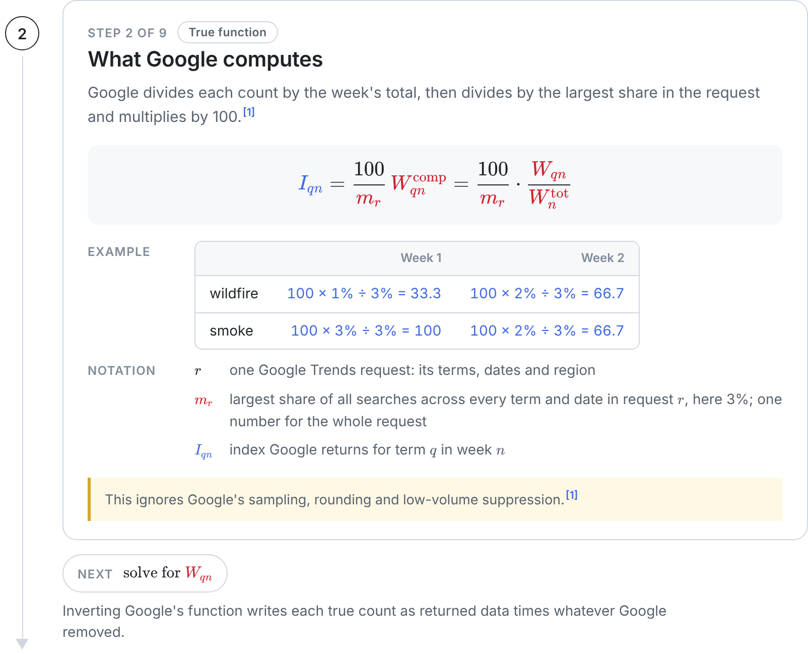
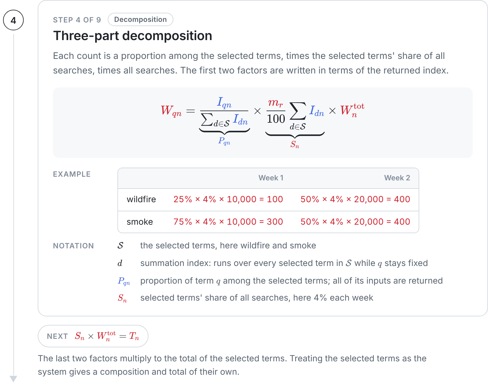
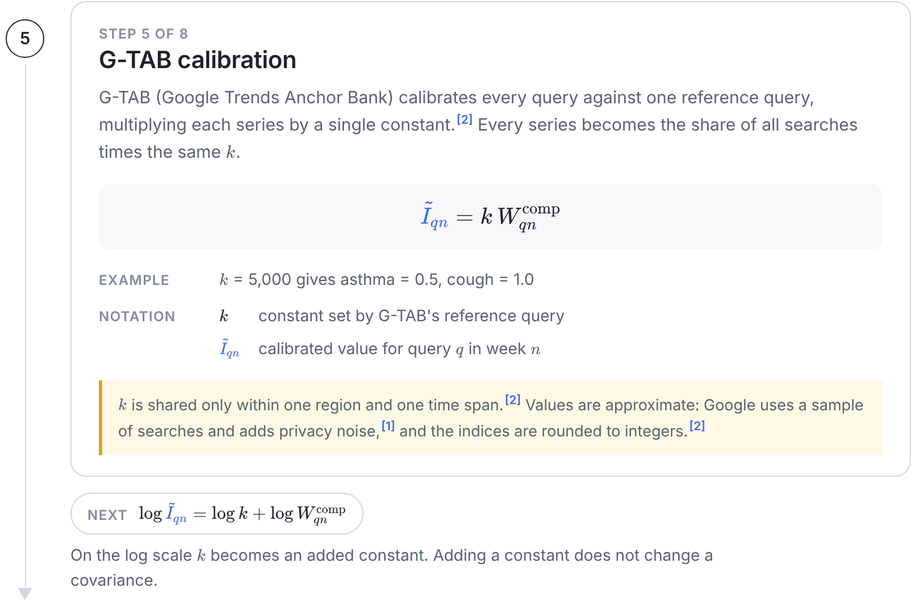
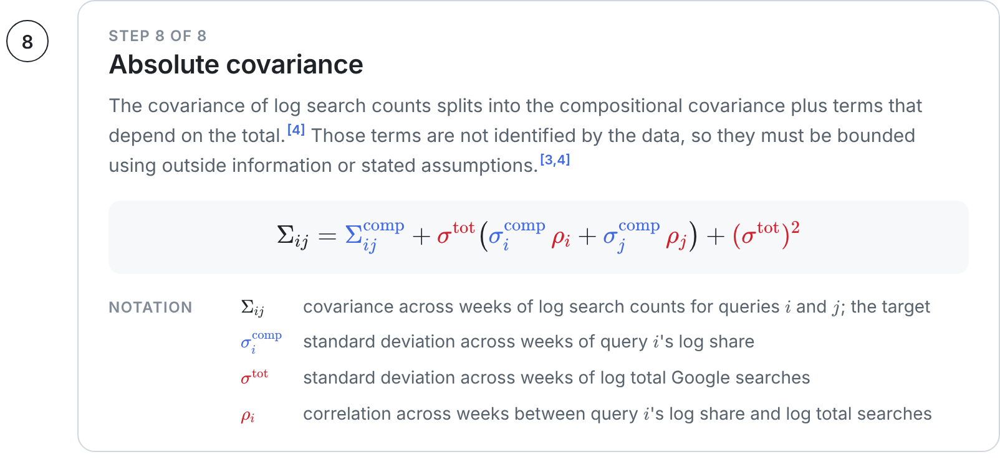

Collect Google Trends data in Python or [R](docs/r-usage.Rmd).


*California · requested 2021–2025 · six terms · 262 weekly dates.
For display, all calibrated values share one rescaling: 100 is the highest
interest across all terms and dates, not each term's own peak.*

## Install

Python 3.9+:

```bash
python -m pip install "git+https://github.com/maxwellkonnaris/googletrends.git@main"
```

## Pull

```python
from trendspull import pull_trends

data = pull_trends(
    ["wildfire", "smoke", "air quality", "asthma", "inhaler", "cough"],
    start="2021-01-01", end="2025-12-31", geo="US-CA",
    min_gap_days=None,  # Keep all dates; use e.g. 28 to space them.
)
data[["date", "keyword", "calibrated_value"]].head()
data.to_csv("trends.csv", index=False)
```

Returns a pandas DataFrame: one row per date, term and region. Up to five terms
share Google's 0–100 scale; larger sets automatically use G-TAB calibration.[^gtab]
`value` preserves the raw index; `calibrated_value` is relative to the first term's
peak (1), so other terms can exceed 1.
Values describe relative search interest, not counts or disease incidence.
Date spacing does not guarantee independence. See [options and output](docs/data-contract.md).

## From Google search counts to compositional covariance

How Google Trends data relate to absolute search counts, what calibration recovers, and what remains unknown.

Here the system includes all Google queries: the scale is total Google searches,
and the selected terms are a subset of that full composition. Normalizing only
the selected terms to sum to 1 instead defines their within-subset composition.
The covariance identity describes the ideal calibrated signal; sampling,
rounding and suppression affect its estimation from observed indices.

<picture>
  <source media="(prefers-color-scheme: dark)" srcset="docs/figures/search-counts/legend-dark.png">
  
</picture>

<picture>
  <source media="(prefers-color-scheme: dark)" srcset="docs/figures/search-counts/step-1-dark.png">
  
</picture>

<picture>
  <source media="(prefers-color-scheme: dark)" srcset="docs/figures/search-counts/step-2-dark.png">
  
</picture>

<picture>
  <source media="(prefers-color-scheme: dark)" srcset="docs/figures/search-counts/step-3-dark.png">
  
</picture>

<picture>
  <source media="(prefers-color-scheme: dark)" srcset="docs/figures/search-counts/step-4-dark.png">
  
</picture>

<picture>
  <source media="(prefers-color-scheme: dark)" srcset="docs/figures/search-counts/step-5-dark.png">
  
</picture>

<picture>
  <source media="(prefers-color-scheme: dark)" srcset="docs/figures/search-counts/step-6-dark.png">
  
</picture>

<picture>
  <source media="(prefers-color-scheme: dark)" srcset="docs/figures/search-counts/step-7-dark.png">
  
</picture>

<picture>
  <source media="(prefers-color-scheme: dark)" srcset="docs/figures/search-counts/step-8-dark.png">
  
</picture>

### References

1. Google. *FAQ about Google Trends data.* Google Trends Help. <https://support.google.com/trends/answer/4365533>
2. West, R. (2020). Calibration of Google Trends time series. *Proceedings of the 29th ACM International Conference on Information and Knowledge Management (CIKM '20).* <https://arxiv.org/abs/2007.13861>
3. Nixon, M. P., McGovern, K. C., Konnaris, M. A., Letourneau, J., David, L. A., Lazar, N. A., Mukherjee, S., & Silverman, J. D. (2026). Scale reliant inference. *The Annals of Applied Statistics*, 20(3), 2125–2147. <https://doi.org/10.1214/26-AOAS2230>
4. Konnaris, M. A., Lazar, N. A., & Silverman, J. D. Scale reliant covariance estimation: with applications in genomic survey data. Manuscript in preparation.

[^gtab]: Robert West (2020). [*Calibration of Google Trends Time Series*](https://doi.org/10.1145/3340531.3412075). CIKM, 2257–2260.
